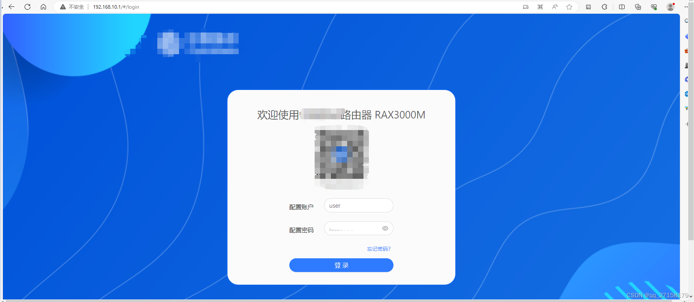
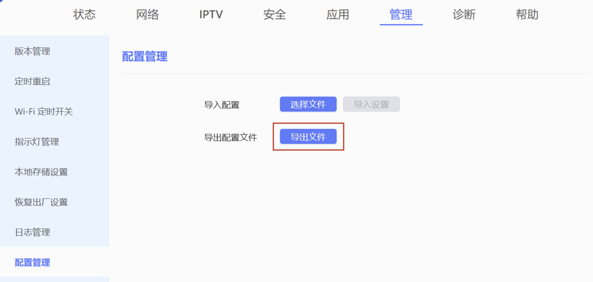
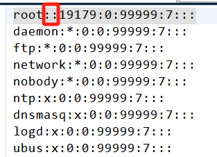
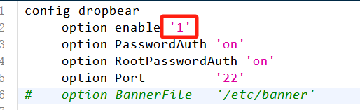
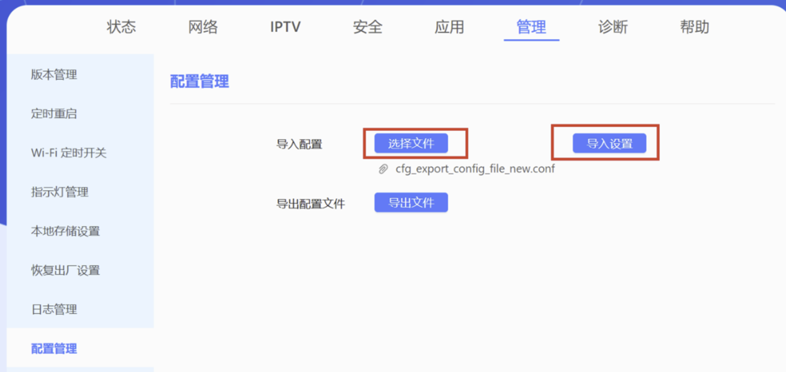
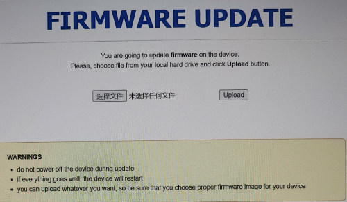
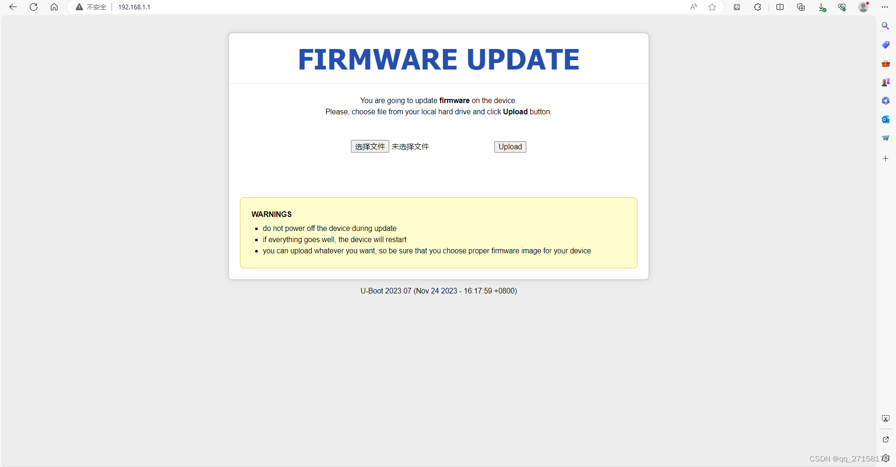
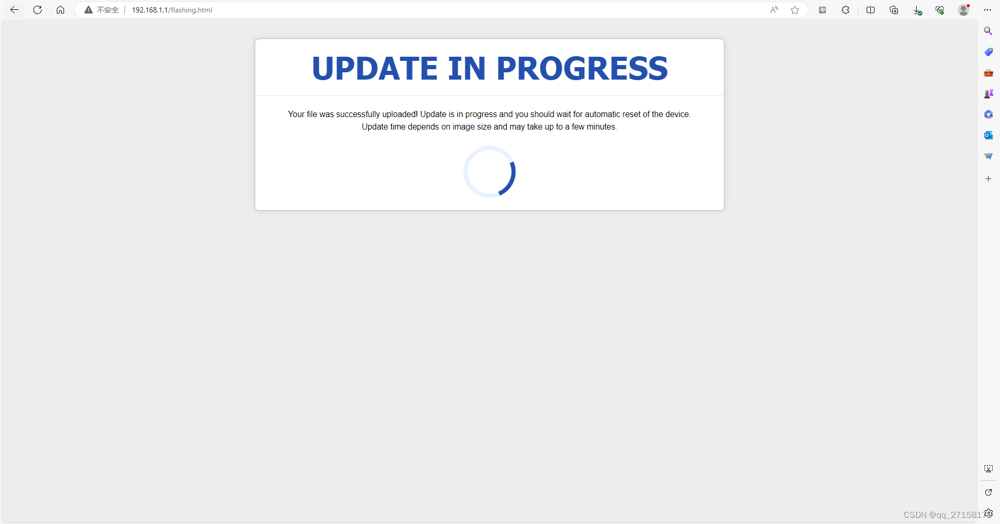

# CMCC rax3000m免拆刷机

> 中国移动CMCC rax3000m免拆机刷入UBOOT和ImmortalWRT固件

> 本教程以NAND版为例,生产日期20231223

> 本教程可供中国移动CMCC rax3000m的NAND、emmc两版本做参考

## 环境准备

* 笔记本一台网线一根
* 操作系统Ubuntu24.04（可以用windows+[hexhub客户端](https://www.hexhub.cn/)）
* 中国移动CMCC rax3000m生产日期20231223（nand版本）


## 登录路由器去除ROOT密码开启SSH

* 路由器通电
* 笔记本电脑通过网线连接路由器的LAN端口
* 笔记本网卡设置成自动获取IP
* 笔记本中打开浏览器并输入地址http://192.168.10.1
* 用户名密码详见设备背面默认值

* 在高级设置->管理->配置管理->导出配置文件、得到:cfg_export_config_file.conf文件


* 在linux系统下，Ubuntu下进行文件配置->开启自带系统的SSH客户端（在一个空目录下进行，以下操作：当前目录下cfg_export_config_file.conf），命令如下：
```bash
# 建议复制以下命令再运行，避免手敲出错
openssl aes-256-cbc -d -pbkdf2 -k $CmDc#RaX30O0M@\!$ -in cfg_export_config_file.conf -out - | tar -zxvf -
```

* 在解压出的etc目录下修改以下两个文件

* 修改文件一 etc/shadow 将两个冒号间的密码删除然后保存



* 修改文件二 etc/config/dropbear 将红框内的0’ 改成‘1’ 然后保存来开启SSH


* 修改完成后、输入以命令、让文件重新打包、导入系统配置、这样我们可以进行SSH连接的配置文件就做好了
```bash
# 打包中会有一些错误，可忽略不影响导入
tar -zcvf - etc | openssl aes-256-cbc -pbkdf2 -k $CmDc#RaX30O0M@\!$ -out cfg_export_config_file_new.conf
```

* 路由器重启后、SSH就打开了
* 通过ssh 192.168.10.1 账号：root、密码：无、进入路由器文件传输界面
```bash
# 密码无
ssh root@192.168.10.1
```

## 选择合适的UBOOT固件刷入
* 刷入UBOOT之前，先备份路由器各分区(备份路由器固件)
```bash
dd if=/dev/mtd0 | gzip > /tmp/mtd0_spi0.bin.gz
# 把/tmp/mtd0_spi0.bin.gz 下载到本地电脑
# scp -O root@192.168.9.1:/tmp/mtd0_spi0.bin.gz ./
# 这个文件占用空间大，备份完删除 rm -rf /tmp/mtd0_spi0.bin.gz
dd if=/dev/mtd1 of=/tmp/mtd1_bl2.bin
dd if=/dev/mtd2 of=/tmp/mtd2_u-boot-env.bin
dd if=/dev/mtd3 of=/tmp/mtd3_factory.bin
dd if=/dev/mtd4 of=/tmp/mtd4_fip.bin
dd if=/dev/mtd5 of=/tmp/mtd5_ubi.bin
dd if=/dev/mtd6 of=/tmp/mtd6_plugins.bin
dd if=/dev/mtd7 of=/tmp/mtd7_fwk.bin
dd if=/dev/mtd8 of=/tmp/mtd8_fwk2.bin
# 批量备份到本地
# scp -O -r root@192.168.9.1:/tmp/mtd*.bin ./
# 删除 rm -rf /tmp/mtd*.bin
```
* 选择合适的UBOOT，并刷入UBOOT
```bash
# 请打开百度网盘下载合适UBOOT
# emmc版本选择：mt7981_cmcc_rax3000m-emmc-fip-fixed-parts.bin
# NAND版本选择：mt7981_cmcc_rax3000m-fip-fixed-parts.bin
# 上传到路由器的/tmp目录下
scp -O mt7981_cmcc_rax3000m-fip-fixed-parts.bin root@192.168.10.1:/tmp
# 进入路由器并用CMCC系统命令行写入
ssh root@192.168.10.1 #命令行登录到路由器也可以用客户端直接进入
mtd write /tmp/mt7981_cmcc_rax3000m-fip-fixed-parts.bin FIP
```
* 进入UBOOT模式:断电路由器(或reboot)，用牙签按住RESET按钮，然后上电，按钮在路由器底部，按下等15秒，等指示灯变绿色，可以松开牙签。
* 连接网线插入路由器Lan口连到电脑、随后我们修改电脑ip为：192.168.1.100保持与uboot（192.168.1.1）在同一个网段
* 在浏览器中输入192.168.1.1网址、随后我们进入了Uboot的刷机界面。


* [nand版](./static/rax3000m/mt7981_cmcc_rax3000m-fip-fixed-parts.bin)
* [其他版本请自行下载](https://pan.baidu.com/s/1c1ZXKI0Zs_jVtf2NRRO2gA?pwd=vh3y)

## 选择合适的ImmortalWRT刷入

* 到[官网](https://downloads.immortalwrt.org/releases/23.05.0/targets/mediatek/filogic/)下载得到以下文件
* [immortalwrt-23.05.0-mediatek-filogic-cmcc_rax3000m-nand-ubootmod-squashfs-sysupgrade.bin](./static/rax3000m/immortalwrt-23.05.0-mediatek-filogic-cmcc_rax3000m-nand-ubootmod-squashfs-sysupgrade.bin)
* 在浏览器中输入192.168.1.1网址打开UBOOT的web页面

* UBOOT的web页面 ==》选择文件[immortalwrt-23.05.0-mediatek-filogic-cmcc_rax3000m-nand-ubootmod-squashfs-sysupgrade.bin](./static/rax3000m/immortalwrt-23.05.0-mediatek-filogic-cmcc_rax3000m-nand-ubootmod-squashfs-sysupgrade.bin) ==》upload ==》update


* 笔记本电脑设置成自动获取路由IP，进入ImmortalWRT的web页面
* 浏览器登录:http://192.168.1.1 (目前没有设置密码)


## 参考文章
* > [文章一](https://blog.csdn.net/qq_27158179/article/details/135440875)
* > [文章二](https://www.cnblogs.com/KairusZhang/p/17987300)