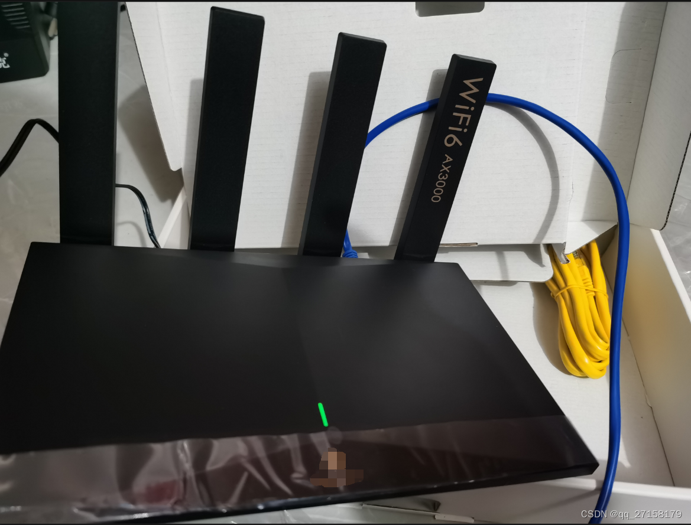

# CMCC rax3000m免拆刷机

> 中国移动CMCC rax3000m免拆机刷入UBOOT和ImmortalWRT固件

> 本教程以NAND版为例,生产日期20231223

> 本教程可供中国移动CMCC rax3000m的NAND、emmc两版本做参考

## 环境准备

* 笔记本一台网线一根
* 操作系统Ubuntu24.04（可以用windows+[hexhub客户端](https://www.hexhub.cn/)）
* 中国移动CMCC rax3000m生产日期20231223（nand版本）
